<div align="center">

<!-- ==================== HERO HEADER ==================== -->


<a href="https://arianpashae.com" target="_blank">
  
</a>

<br /><br />

<!-- ==================== TYPING INTRO ==================== -->
<a href="https://arianpashae.com" target="_blank">
  
</a>

<br />

<!-- ==================== PRIMARY COMMAND BAR ==================== -->
<p align="center">
  <a href="https://arianpashae.com" target="_blank"></a>
  <a href="https://landkhooneh.com" target="_blank"></a>
  
  <a href="https://gitstalk.netlify.app/ArianPashae/" target="_blank"></a>
</p>


</div>

<br />

<!-- ==================== SYSTEM BLUEPRINT ==================== -->
<div align="center">
  
  <h2>Full-Stack Architect × AI & Systems Builder</h2>
  <p><b>Building high-impact digital ecosystems — uniting enterprise web software, NVMe cloud & telecom infrastructure, autonomous AI workflows, and open-source systems engineering.</b></p>
</div>

```ts
class ArianPashae {
	readonly role = "Founder & Principal Full-Stack / AI Architect";
	readonly holding = "Landkhooneh — Cloud Innovation & Tech Holding";
	readonly remoteSince = 2020;

	readonly coreFocus = [
		"Enterprise Web Platforms, UI/UX & Technical SEO",
		"Multi-Agent LLM Orchestration, RAG & Workflow Automation",
		"NVMe Gen4 Cloud Servers & Sub-3s OTP Telecom Gateways",
		"C / Go / Rust / TypeScript Upstream Systems Engineering"
	];

	readonly philosophy = "Ship clean code. Craft sharp UX. Engineer for resilience.";
}
```

<br />

<table>
  <tr>
    <td valign="top" width="33%" align="center">
      
      <h4>AI & Automation Lab</h4>
      <sub>LLM copilots, multi-step RAG pipelines, vector search, autonomous bots, and executive telemetry panels.</sub>
    </td>
    <td valign="top" width="33%" align="center">
      
      <h4>Enterprise Web & APIs</h4>
      <sub>Next.js / TypeScript portals, CRM/ERP architectures, REST & GraphQL backends, and sub-3s OTP gateways.</sub>
    </td>
    <td valign="top" width="33%" align="center">
      
      <h4>Cloud & Edge Infra</h4>
      <sub>NVMe Gen4 & LiteSpeed clusters, Dockerized services, Nginx reverse proxies, Cloudflare WAF, and CI/CD.</sub>
    </td>
  </tr>
</table>

---

<!-- ==================== LANDKHOONEH HOLDING ECOSYSTEM ==================== -->
<div align="center">
  
  <h2><a href="https://landkhooneh.com" target="_blank">Landkhooneh</a> — Cloud Innovation & Tech Holding</h2>
  <p><b>Five specialized technology divisions delivering end-to-end digital infrastructure and software products.</b></p>

  <p align="center">
    
    
    
    
    
  </p>
</div>

<table>
  <tr>
    <td align="center" valign="top" width="20%">
      
      <h4><a href="https://webkhooneh.com" target="_blank">WEB khooneh</a></h4>
      <sub>Custom Web, UI/UX & Technical SEO</sub>
    </td>
    <td align="center" valign="top" width="20%">
      
      <h4>HOST khooneh</h4>
      <sub>NVMe Gen4 Cloud & LiteSpeed Servers</sub>
    </td>
    <td align="center" valign="top" width="20%">
      
      <h4><a href="https://smskhooneh.ir" target="_blank">SMS khooneh</a></h4>
      <sub>&lt;3s OTP APIs & Service SMS Lines</sub>
    </td>
    <td align="center" valign="top" width="20%">
      
      <h4>LEARN khooneh</h4>
      <sub>Project-Based IT Academy & Mentorship</sub>
    </td>
    <td align="center" valign="top" width="20%">
      
      <h4>MEDIA khooneh</h4>
      <sub>Motion Graphics & Growth Media</sub>
    </td>
  </tr>
</table>

---

<!-- ==================== UPSTREAM OPEN-SOURCE CONTRIBUTIONS ==================== -->
<div align="center">
  
  <h2>Verified Upstream Contributions</h2>
  <p><b>Merged pull requests and active C/C++, Rust, Go, and TypeScript bug fixes across global open-source software.</b></p>
</div>

<table>
  <tr>
    <td valign="top" width="50%">
      <h4>🦀&nbsp;<a href="https://github.com/storytold/photocraft" target="_blank">Photocraft (GPU Image Editor)</a></h4>
      <p>Hardened repository hygiene and build environments by removing stray test/lint log artifacts and enforcing root ignore rules (Issue <a href="https://github.com/storytold/photocraft/issues/1154" target="_blank">#1154</a>).</p>
      <a href="https://github.com/storytold/photocraft/pull/1155" target="_blank"></a>
      
      
    </td>
    <td valign="top" width="50%">
      <h4>🧠&nbsp;<a href="https://github.com/morluto/rea" target="_blank">Rea (Agentic Reverse Engineering)</a></h4>
      <p>Patched cross-platform installer execution under <code>set -u</code> on macOS Bash 3.2 environments, eliminating unbound variable aborts.</p>
      <a href="https://github.com/morluto/rea/pull/1061" target="_blank"></a>
      
      
    </td>
  </tr>
  <tr>
    <td valign="top" width="50%">
      <h4>⚡&nbsp;<a href="https://github.com/v2rayA/v2rayA" target="_blank">v2rayA (Universal Linux Routing Engine)</a></h4>
      <p>Eliminated critical <code>SQLITE_CONSTRAINT_FOREIGNKEY</code> (787) failures during batch proxy node deletions (Issue <a href="https://github.com/v2rayA/v2rayA/issues/2065" target="_blank">#2065</a>) by safely dropping obsolete legacy schema tables.</p>
      <a href="https://github.com/v2rayA/v2rayA/pull/2080" target="_blank"></a>
      
      
    </td>
    <td valign="top" width="50%">
      <h4>🪶&nbsp;<a href="https://github.com/SalamLang/Salam" target="_blank">Salam Programming Language</a></h4>
      <p>Authored <b>11 merged C runtime & stdlib fixes</b> covering self-extension UAF (<a href="https://github.com/SalamLang/Salam/pull/3646" target="_blank">#3646</a>), heap read clamping (<a href="https://github.com/SalamLang/Salam/pull/3048" target="_blank">#3048</a>), memory leaks (<a href="https://github.com/SalamLang/Salam/pull/3039" target="_blank">#3039</a>, <a href="https://github.com/SalamLang/Salam/pull/3054" target="_blank">#3054</a>), and parser guarantees (<a href="https://github.com/SalamLang/Salam/pull/3042" target="_blank">#3042</a>).</p>
      <a href="https://github.com/SalamLang/Salam/pulls?q=is%3Apr+author%3AArianPashae+is%3Amerged" target="_blank"></a>
      
      
    </td>
  </tr>
  <tr>
    <td valign="top" width="50%">
      <h4>🤖&nbsp;<a href="https://github.com/aiblueprinthq/ai-blueprint" target="_blank">AI Blueprint (by Brad Traversy)</a></h4>
      <p>Hardened CLI dashboard against Git worktree/index race crashes (Issue <a href="https://github.com/aiblueprinthq/ai-blueprint/issues/33" target="_blank">#33</a>) with porcelain error guards across 58 tests.</p>
      <a href="https://github.com/aiblueprinthq/ai-blueprint/pull/34" target="_blank"></a>
      
    </td>
    <td valign="top" width="50%">
      <h4>🗺️&nbsp;<a href="https://github.com/salehghari/ganjineh-street" target="_blank">Ganjineh Street — Web Platform</a></h4>
      <p>Core collaborator for <b>ganjinehstreet.ir</b>. Fixed Next.js 15 dynamic routing bugs, hint timer closure leaks, and hydration stability.</p>
      <a href="https://github.com/salehghari/ganjineh-street/pull/2" target="_blank"></a>
      
    </td>
  </tr>
</table>

<div align="center">
  <h4>⚙️ Active Systems & Core Infrastructure PRs (Live Status)</h4>
</div>

<table>
  <tr>
    <td valign="top" width="33%">
      <h4>🗄️&nbsp;<a href="https://github.com/redis/redis" target="_blank">Redis</a></h4>
      <sub>Fixed lazy parsing omission in <code>RedisModule_CallReplyAttribute()</code>, type mismatch in attribute elements, and context inheritance.</sub>
      <br /><br />
      <a href="https://github.com/redis/redis/pull/16368" target="_blank"></a>
      
    </td>
    <td valign="top" width="33%">
      <h4>⚡&nbsp;<a href="https://github.com/valkey-io/valkey" target="_blank">Valkey</a></h4>
      <sub>Guarded early IO-thread replication writes before ACK (<a href="https://github.com/valkey-io/valkey/pull/5509" target="_blank">#5509</a>) & protected AOF files on post-rename dirsync failures (<a href="https://github.com/valkey-io/valkey/pull/5590" target="_blank">#5590</a>).</sub>
      <br /><br />
      <a href="https://github.com/valkey-io/valkey/pull/5509" target="_blank"></a>
      <a href="https://github.com/valkey-io/valkey/pull/5590" target="_blank"></a>
      
    </td>
    <td valign="top" width="33%">
      <h4>🌐&nbsp;<a href="https://github.com/curl/curl" target="_blank">cURL</a></h4>
      <sub>Fixed Windows <code>--cert</code> parser stripping leading UNC backslashes (<code>\\server\share</code>) and extended device paths (<code>\\?\c:\</code>).</sub>
      <br /><br />
      <a href="https://github.com/curl/curl/pull/24147" target="_blank"></a>
      
    </td>
  </tr>
</table>

---

<!-- ==================== FEATURED PERSONAL PROJECTS ==================== -->
<div align="center">
  
  <h2>Featured Personal Projects</h2>
</div>

<table>
  <tr>
    <td valign="top" width="50%">
      <h4>📅&nbsp;<a href="https://github.com/ArianPashae/AzadWeekBot" target="_blank">AzadWeekBot — Academic Calendar Bot & Mini App</a></h4>
      <sub>Smart Telegram Bot and native WebApp / PWA engineered for Islamic Azad University students to track Odd & Even academic weeks.</sub>
      <br /><br />
      <a href="https://github.com/ArianPashae/AzadWeekBot" target="_blank"></a>
      
    </td>
    <td valign="top" width="50%">
      <h4>🎨&nbsp;<a href="https://github.com/ArianPashae/ArianPashae-Discord-Theme" target="_blank">ArianPashae Discord Theme</a></h4>
      <sub>Sleek Obsidian & Cyber-Violet theme tailored for Vencord, BetterDiscord, and Vesktop clients with refined contrast and token styling.</sub>
      <br /><br />
      <a href="https://github.com/ArianPashae/ArianPashae-Discord-Theme" target="_blank"></a>
      
    </td>
  </tr>
</table>

---

<!-- ==================== TECH ARSENAL ==================== -->
<div align="center">
  
  <h2>Core Tech Arsenal</h2>

  <p><b>Frontend & Interactive UI</b></p>
  

  <br /><br />

  <p><b>Backend, Systems, Data & AI</b></p>
  

  <br /><br />

  <p><b>Cloud Infra, DevOps, 3D & Workstation</b></p>
  
</div>

---

<!-- ==================== GITHUB COMMAND CENTER ==================== -->
<div align="center">
  
  <h2>GitHub Command Center</h2>

  <table>
    <tr>
      <td align="center" valign="middle" width="50%">
        
      </td>
      <td align="center" valign="middle" width="50%">
        
      </td>
    </tr>
    <tr>
      <td align="center" valign="middle" width="50%">
        
      </td>
      <td align="center" valign="middle" width="50%">
        
      </td>
    </tr>
  </table>

  
</div>

<br />

<details>
  <summary> <b>Achievement Wall (Click to Expand)</b></summary>
  <br />
  <div align="center">
    
  </div>
</details>

---

<!-- ==================== CONTRIBUTION STREAM ==================== -->
<div align="center">
  
  <h2>Contribution Stream</h2>

  <picture>
    <source media="(prefers-color-scheme: dark)" srcset="https://raw.githubusercontent.com/ArianPashae/ArianPashae/output/github-contribution-grid-snake-dark.svg" />
    <source media="(prefers-color-scheme: light)" srcset="https://raw.githubusercontent.com/ArianPashae/ArianPashae/output/github-contribution-grid-snake.svg" />
    
  </picture>
</div>

---

<!-- ==================== CONNECT & SUPPORT ==================== -->
<div align="center">
  
  <h2>Initiate Collaboration</h2>
  <p>Have an ambitious product, AI platform, or systems challenge in mind? Let's architect and ship it.</p>

  <p align="center">
    <a href="https://arianpashae.com" target="_blank"></a>
    <a href="https://landkhooneh.com" target="_blank"></a>
    <a href="https://www.linkedin.com/in/arian-pashae/" target="_blank"></a>
  </p>
  <p align="center">
    <a href="https://t.me/ArianPashae" target="_blank"></a>
    <a href="https://instagram.com/arianpashae" target="_blank"></a>
    <a href="https://discordapp.com/users/941442983084040222" target="_blank"></a>
    <a href="https://wa.link/8x8t9x" target="_blank"></a>
    <a href="mailto:info@arianpashae.com"></a>
  </p>

  <br />

  <!-- ==================== SUPPORT ==================== -->
  <p><b>Fuel open-source development with a coffee ☕</b></p>
  <p align="center">
    <a href="https://www.coffeebede.com/arianpashae" target="_blank" rel="noopener"></a>
  </p>

  <br />

  

  <br />

  
</div>

<!-- Thanks for visiting! ✨ -->
